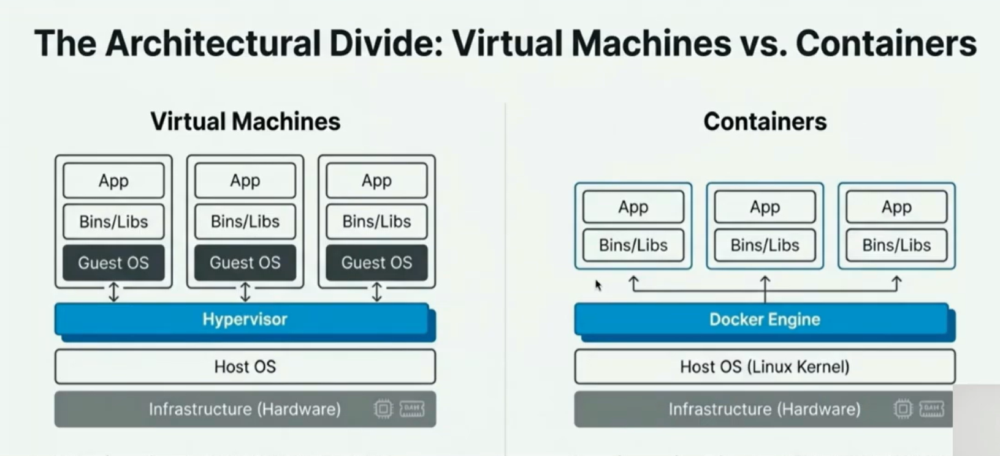
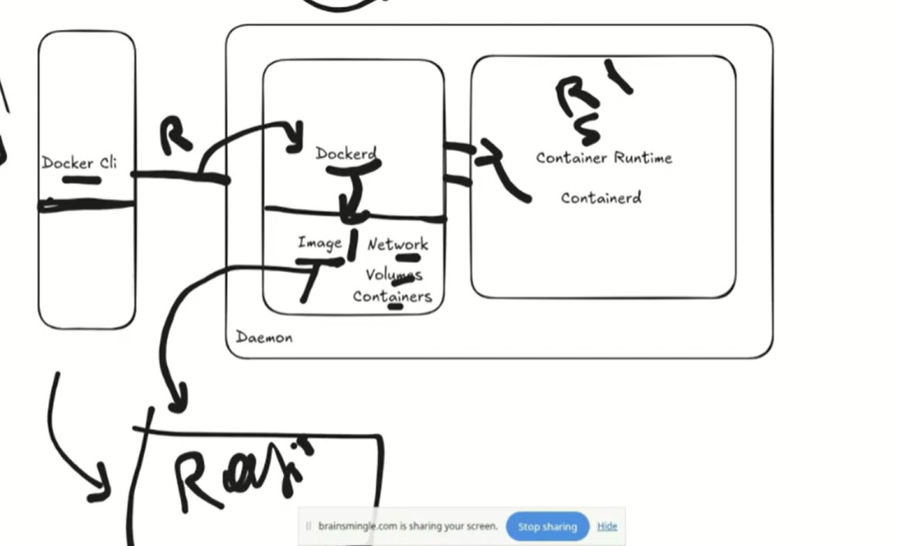

# Docker Fundamentals

- Containers are useful for isolation and density (maximum resource utilization)
- Docker is one of the existing container engines (others include Podman)
- VM Template = Docker Image (to run a container from)
- Two main features of the Linux kernel, called cgroups and namespaces, enable CPU allocation for containers on a machine (a container can use a percentage of a VM's CPU).

> Commands are executed from Docker Desktop or the Docker CLI, which then calls Docker daemon through REST API. Docker daemon (the engine) consists of dockerd (the Docker server) and containerd. Dockerd manages the images by checking whether they exist locally or downloading them from a Docker registry, and it also manages the network which is used to let two containers (like an app and a database) communicate with each other, and it also manages the volumes and container status. containerd is the container runtime responsible for only starting, restarting, stopping and deleting the containers.

> All containers must be built on Linux. (macOS and Windows create a VM to support this.)

- The docker commit command creates a Docker image out of an existing container.
- To tell whether an image on Docker Hub is official, look for an underscore in the image URL (ex: hub.docker.com/_/nginx)
- The tag is like the image version (if not specified, it will bring the latest version).
