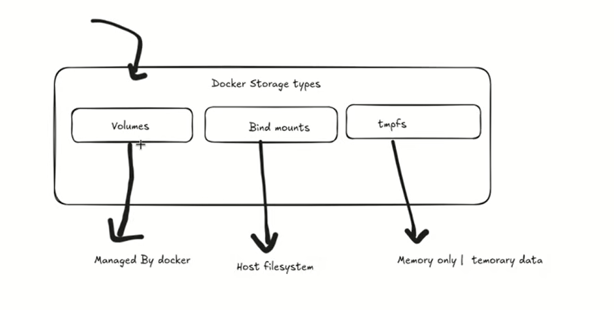

# Docker Storage

- `Volume`: docker volume create mydata | docker -v mydata : container_path_where_data_is_saved (attach volume)
- `Bind Mount`: docker ...... -v path_on_host_file_system : path_on_container
