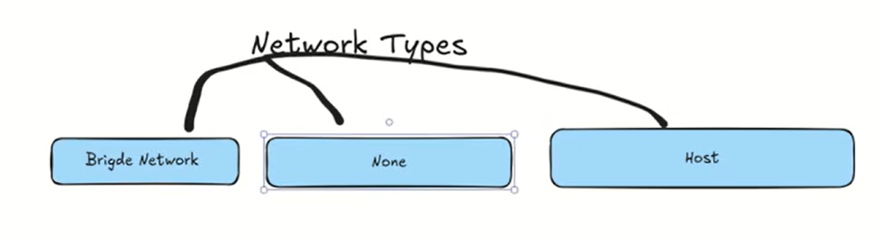
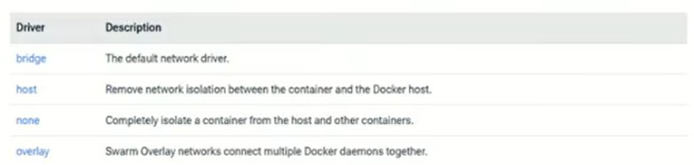
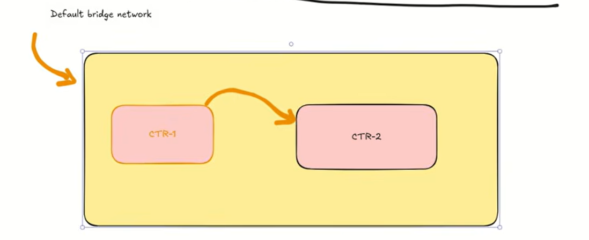

# Docker Networks

## Network Types

### Default Bridge Network
- Containers use the default bridge network by default, where they can communicate only by IP address because there is no DNS.

### Custom Bridge Network
- `Network`: docker network create mynetwork | docker ...... --network mynetwork (attach network)
	- With this network attached, containers can communicate by hostname, IP address, or container name because DNS is provisioned.

### Overlay Network
- Communication between multiple containers on different nodes/servers.

