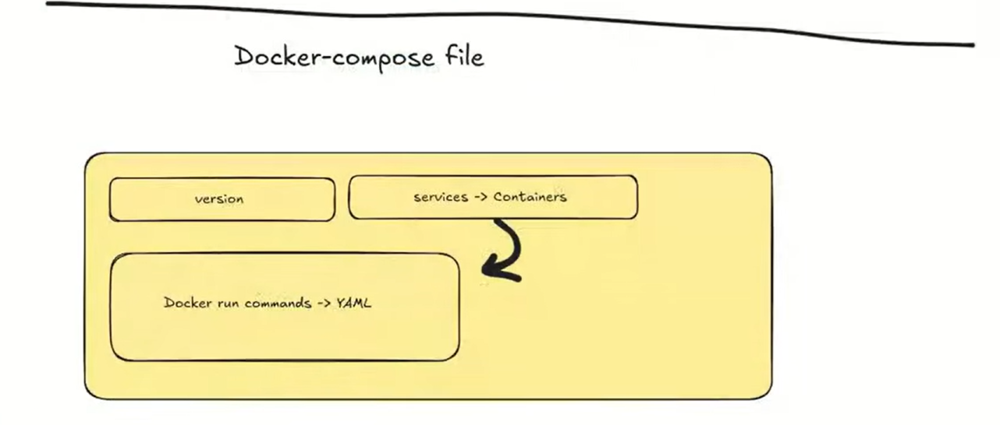

# Docker Compose

- This tool was invented to manage containers instead of creating them on the fly.
- It uses a `yml` file that consists of the following:



example:

```yaml
version: "3.8"
services:
  wordpress:
    image: wordpress:latest
    ports:
      - "8080:80"
    environment:
      WORDPRESS_DB_HOST: mysql
    depends_on:
      - mysql
    volumes:
      - data-wp:/var/www/html
  mysql:
    image: mysql:8.0
    environment:
      MYSQL_DATABASE: wordpressdb
    volumes:
      - mysql-data-wp:/var/lib/mysql
volumes:
  mysql-data-wp:
  data-wp:
```

You can use commands like:
- docker-compose up > start services/containers
- docker-compose ps > show services
- docker-compose down > stop services

Note:
- docker-compose creates `network` by default.
- you can scale or create multiple replicas from a container using this option

```yaml
services:
  test:
    image: test
    deploy:
      replicas: 10
```
