# Dockerfile

file example:

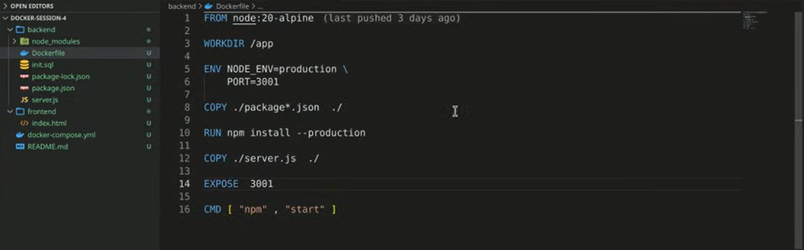

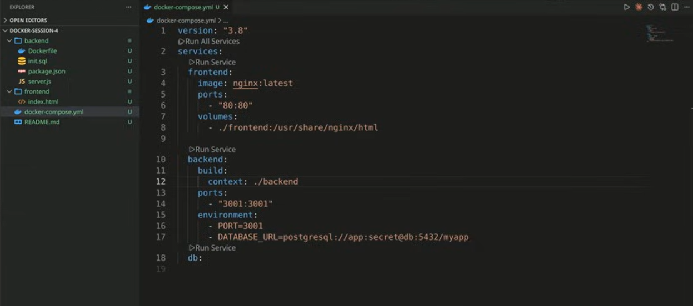

- build > context : means the Dockerfile you need to build will exist in that context folder.

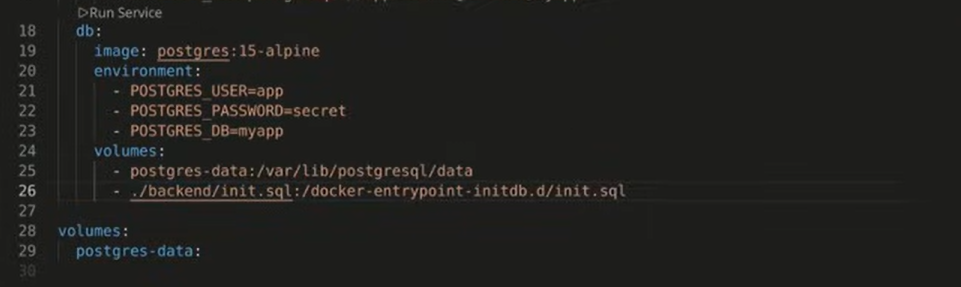

- For the network, rather than leaving everything on one network, we need it to be isolated. The frontend can communicate only with the backend, and only the backend can communicate with the database.

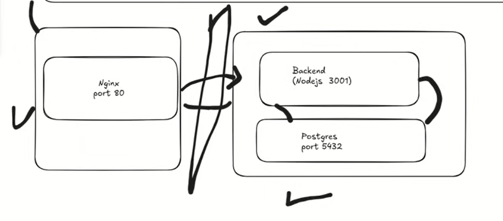

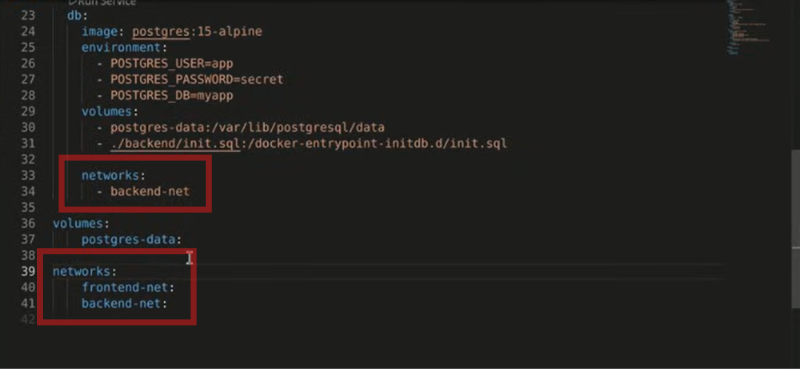

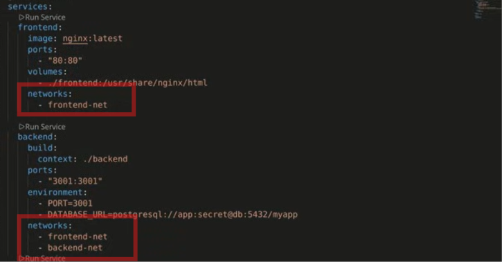

## Changing the root user

> Use the command `ps auxf`

- The user is root.
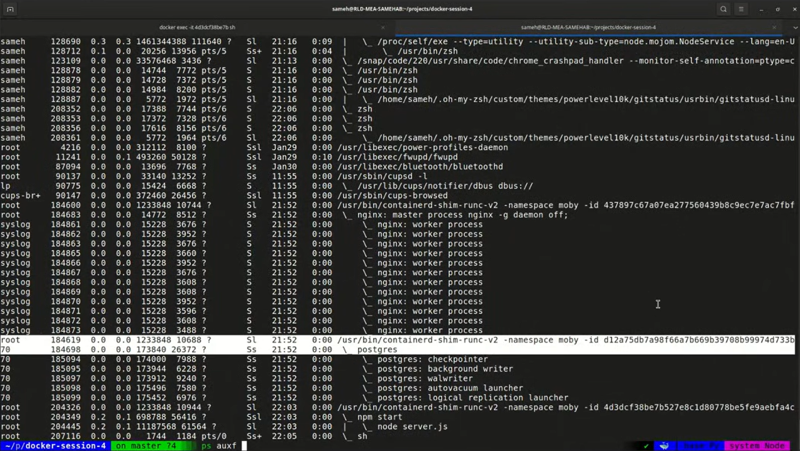

> Changing the owner and user

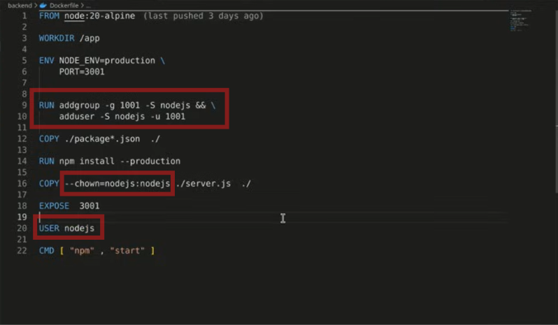
1. Created a group and a user.
2. Changed the owner of the source code file.
3. Switched to that user before executing the command.

- The user ID changed to 1001.
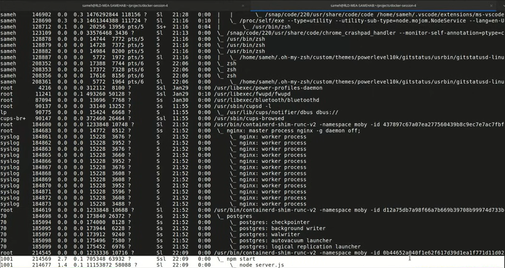

## Use the dependency to control the order

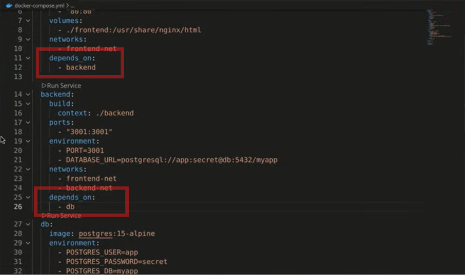

- `frontend` depends on `backend` and `backend` depends on `db`, so `db` starts first, then `backend` then `frontend`.

## Using healthcheck

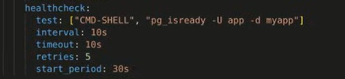

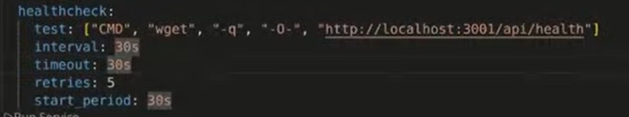

- When a container is unhealthy, the following occurs
	- **The container keeps running.** Docker marks the container status as `(unhealthy)` in `docker ps` and fires a `health_status: unhealthy` Docker event, without killing or restarting the process.
	- **Dependent services block or abort.** If another service uses `depends_on` with `condition: service_healthy`, Docker Compose will wait until the dependency is healthy. If the dependency transitions to `unhealthy` during startup, Compose halts startup and reports an error (`dependency failed to start: container is unhealthy`).

## Protect your credentials

- using env file is unsafe at all if repo is compromised ❌

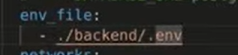

- instead, use secrets and save that file on your server ✅

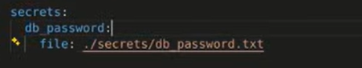

> Grant the container access to the secret like this:

```yaml
services:
  db:
    image: postgres:16
    secrets:
      - db_password
```

> `.dockerignore` file prevents things from being passed to my image.

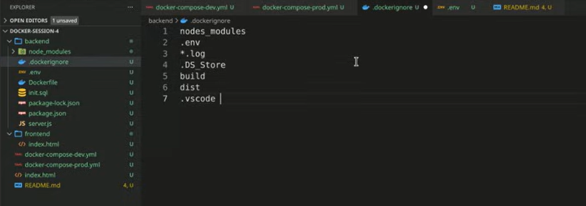

## Use multi-stage builds

- You can use a multi-stage build to separate the build from runtime and reduce the size of your Docker image.

original

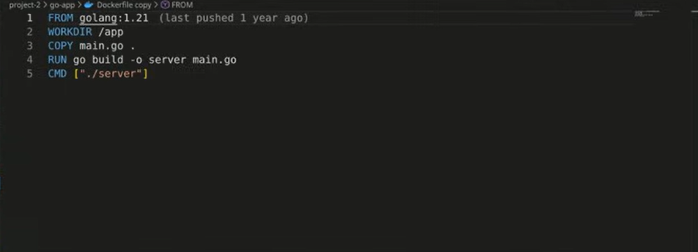

optimized

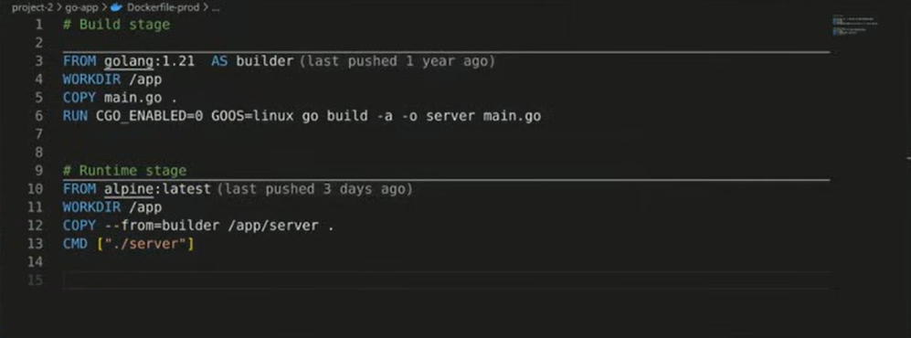

> This can save time in your pipeline.

(Compare the two sizes.)
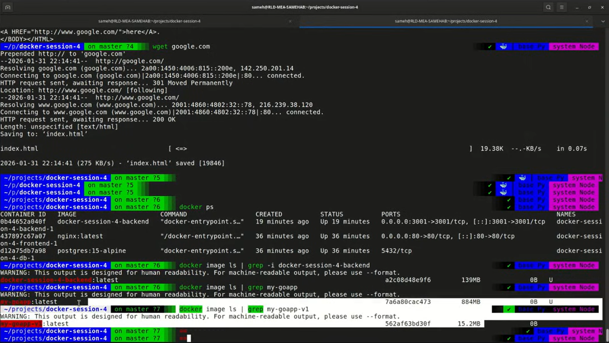

- You can use some commands to check your image for vulnerabilities like `scout` or `trivy`.
- You can limit resource usage for some apps or containers as shown below:

  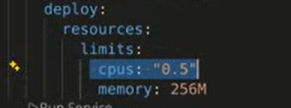

- To store your image privately, create a private repository on `docker hub` or `github container registry` or `AWS ECR` or any other platform, so you can push and pull your image from.
