# Dockerfile Best Practices

## The Four Pillars of `Container Excellence`

### Part 1: Image Selection & Architecture

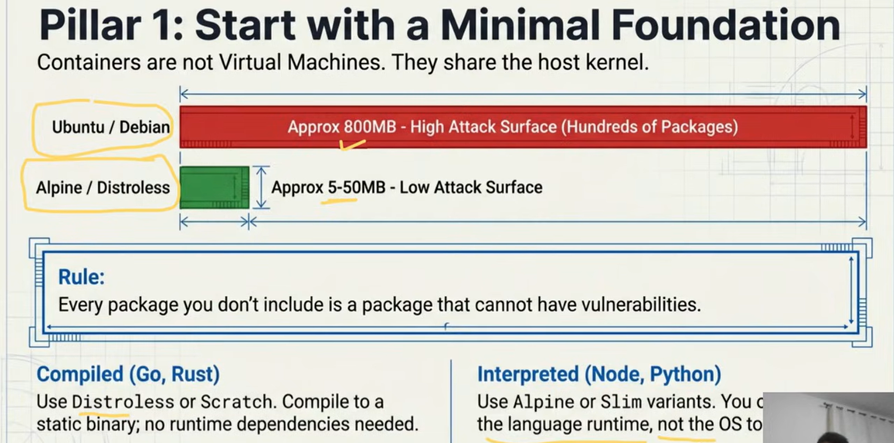

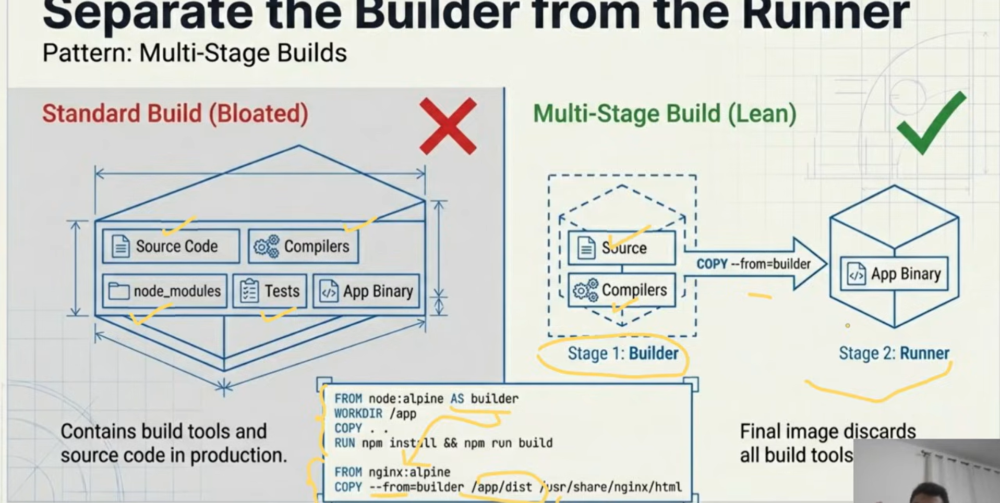

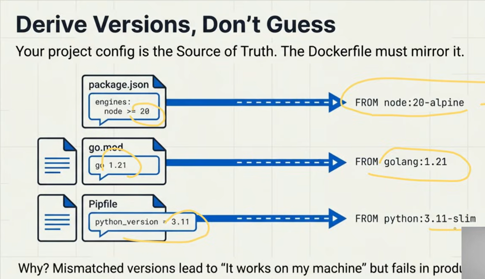

### Part 2: Build Speed & Layer Caching

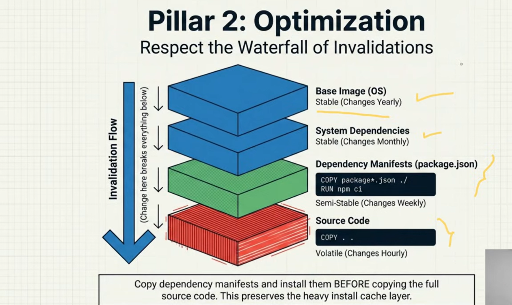

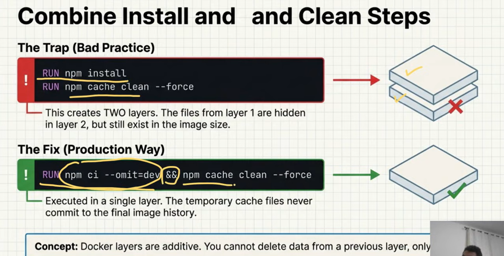

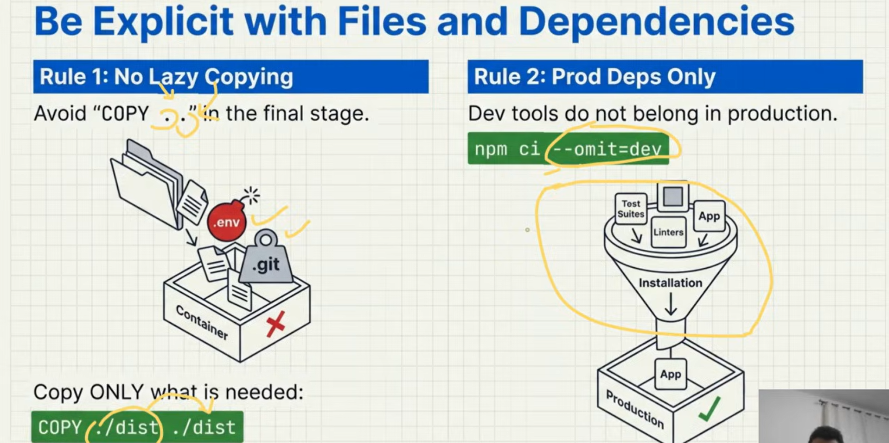

- Create multiple Dockerfiles, one for development, one for testing, and one for production.

### Part 3: Security Hardening

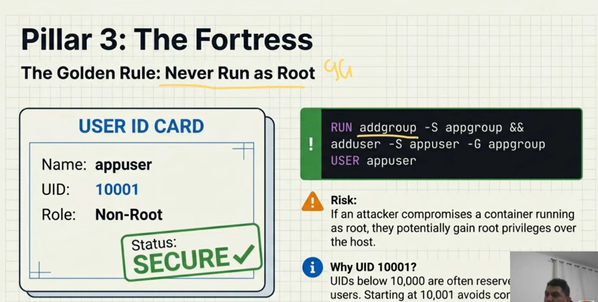

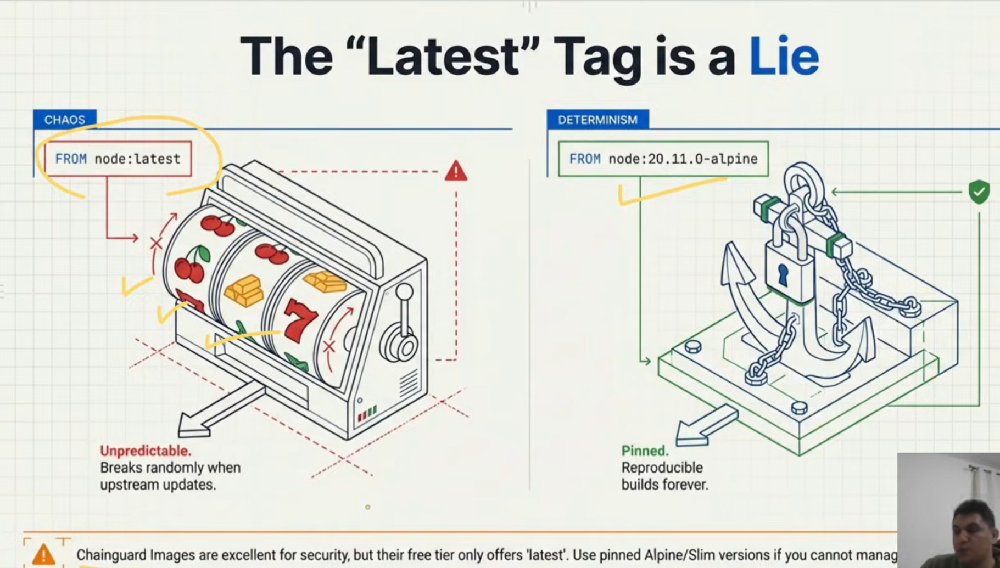

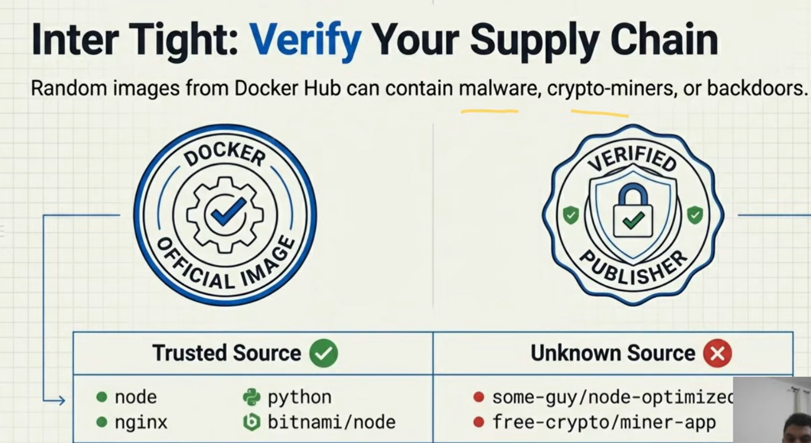

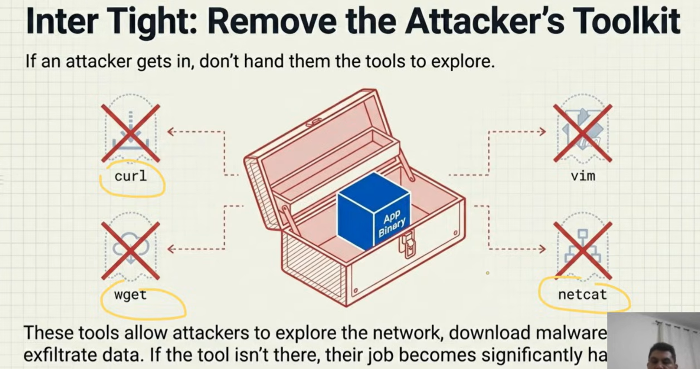

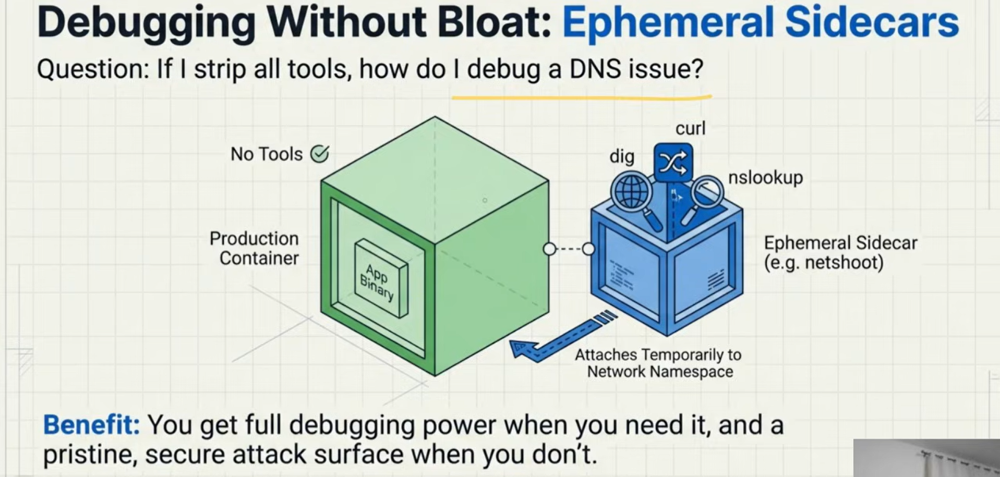

- You can create a new container (ephemeral container) to debug your main container.

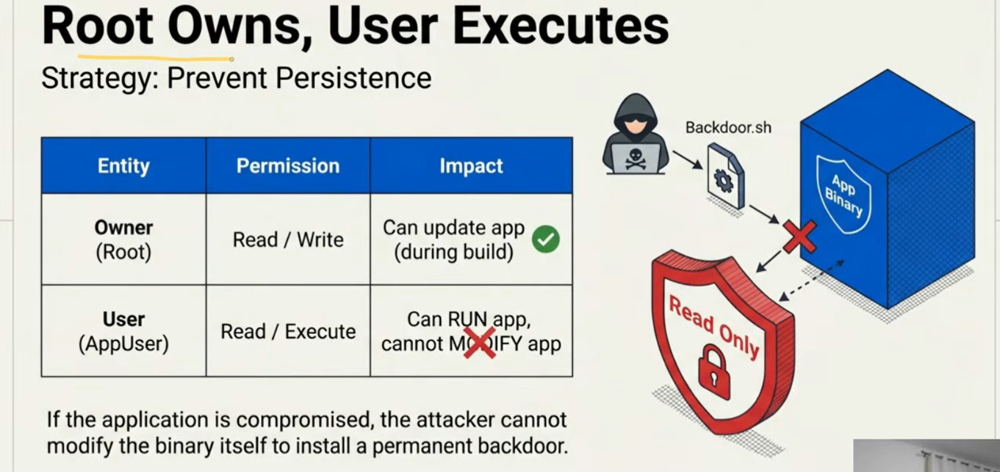

### Part 4: Dev Experience & Documentation

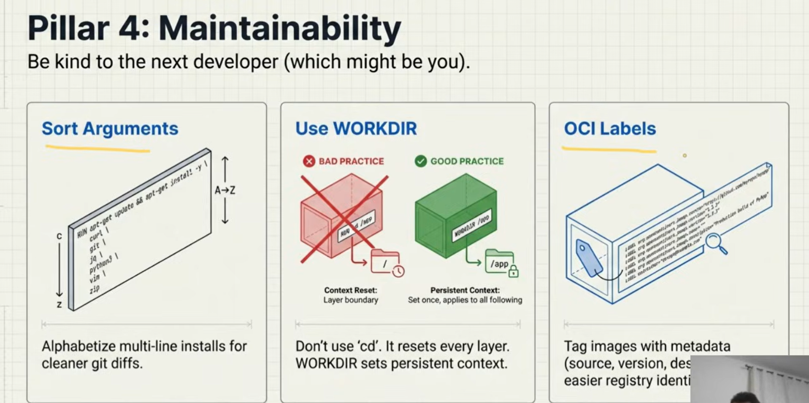

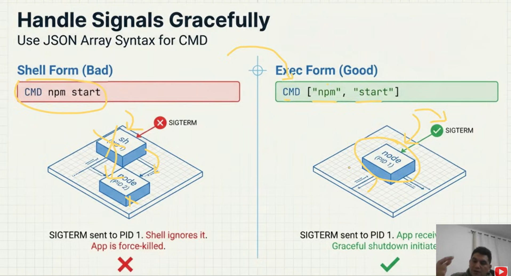

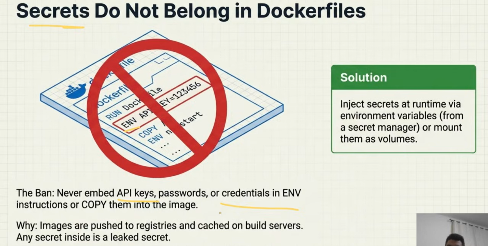

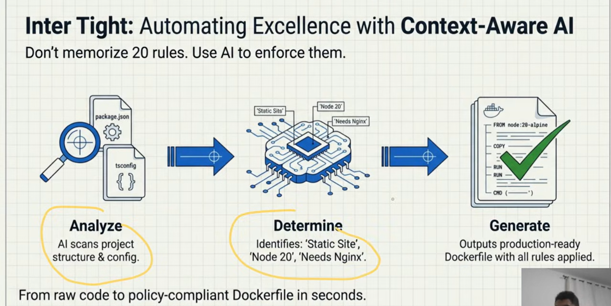
